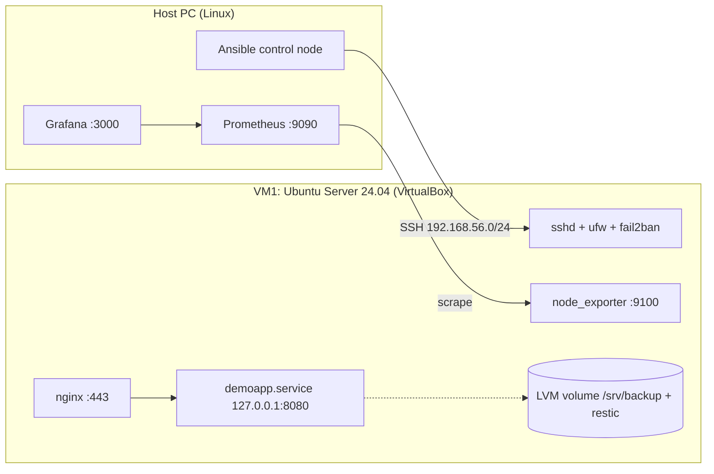

# Mini Infra Lab

A small, reproducible Linux infrastructure lab: a hardened Ubuntu Server 24.04 VM, a custom systemd service behind an nginx reverse proxy, encrypted backups, monitoring with Prometheus and Grafana, and the whole server configuration automated with Ansible.

The goal was to build one server by hand first, understand every step, and then rebuild it from a clean install with a single command.

## Architecture



- **Network:** VirtualBox with two adapters: NAT (internet for `apt`) and Host-only `192.168.56.0/24` (SSH, monitoring, Ansible). The VM has the static address `192.168.56.10`, configured with netplan.
- **Why Ansible and monitoring run on the host:** the host is a normal control node, and it saved resources on a machine with limited disk and RAM.

## What is inside

| Area | What was done | Tools |
|---|---|---|
| Access | Key-only SSH, root login disabled, `MaxAuthTries 3`, drop-in config that overrides cloud-init defaults | OpenSSH, `sshd_config.d` |
| Network security | Default deny incoming, SSH allowed only from the lab network, brute-force protection | ufw, fail2ban |
| Services | Custom service running as a dedicated system user with sandboxing options, plus a systemd timer | systemd, journald |
| Storage | Second virtual disk, LVM (PV, VG, LV), ext4, persistent mount by UUID, online resize | LVM, fstab |
| Backups | Encrypted, deduplicated backups with retention policy and a tested restore | restic, systemd service and timer |
| Web | Reverse proxy with HTTPS (self-signed certificate) and HTTP to HTTPS redirect | nginx, openssl |
| Monitoring | Host metrics and a disk usage alert | Prometheus, Grafana, node_exporter, Docker Compose |
| Automation | Idempotent roles that rebuild the server from a clean install | Ansible |

## Repository structure

```text
mini_infra_project/
├── README.md
├── ansible/
│   ├── ansible.cfg
│   ├── inventory.ini
│   ├── site.yml
│   ├── group_vars/lab.yml
│   └── roles/
│       ├── base/        # packages
│       ├── ssh/         # sshd hardening (validated with sshd -t)
│       ├── firewall/    # ufw rules, fail2ban
│       ├── app/         # system user, systemd unit, app content
│       └── nginx/       # reverse proxy, TLS certificate
├── monitoring/
│   ├── docker-compose.yml
│   └── prometheus.yml
└── docs/
    └── screenshots/
```

## How to reproduce

1. Create a VirtualBox VM with Ubuntu Server 24.04 (OpenSSH server installed), Adapter 1 NAT and Adapter 2 Host-only.
2. Set the static address on the host-only interface with netplan (`192.168.56.10/24`) and copy your public key: `ssh-copy-id -i ~/.ssh/id_ed25519.pub <user>@192.168.56.10`.
3. On the host, install Ansible (`pipx install --include-deps ansible`) and run:

```bash
cd ansible
ansible vm1 -m ping
ansible-playbook site.yml --check --diff -K    # dry run
ansible-playbook site.yml -K                   # apply
```

4. Start monitoring on the host:

```bash
cd monitoring
docker compose up -d
```

Prometheus is at `http://localhost:9090`, Grafana at `http://localhost:3000`. In Grafana add a Prometheus data source with the URL `http://prometheus:9090` and import dashboard ID 1860 (Node Exporter Full).

## Verification

- **Idempotence:** the second `ansible-playbook` run reports `changed=0`.
- **Rebuild test:** VM reverted to a snapshot containing only netplan and an SSH key, then rebuilt completely by the playbook.
- **Web:** `curl -k https://192.168.56.10` returns the app through nginx.
- **Backups:** a file was deleted on purpose and restored from a restic snapshot.
- **Monitoring:** target `vm1` is UP in Prometheus; the disk alert goes Normal, Pending, Firing and back when a large file is created and removed.

Screenshots: 

## Backups

restic stores an encrypted repository on a separate LVM volume. Each run creates a snapshot, deduplicated against previous ones, followed by a retention policy (7 daily, 4 weekly, 3 monthly). A backup that has never been restored is not a backup, so the restore was tested explicitly.

## Troubleshooting log

Real problems I hit while building this, and what they taught me.

| Symptom | Cause | Fix |
|---|---|---|
| SSH hardening had no effect | The file was created in `ssh_config.d` (client) instead of `sshd_config.d` (server) | Moved it, checked with `sshd -T` |
| Option values ignored | In `sshd_config.d` the first value wins, and `50-cloud-init.conf` sets `PasswordAuthentication yes` | Named the file `01-hardening.conf` so it loads first |
| `ssh-copy-id` copied many keys | Without `-i` it copies every key loaded in ssh-agent | Always use `-i <key>.pub`, then clean `authorized_keys` |
| fail2ban never banned my test | With password login disabled, `PubkeyAuthentication=no` produces failures the default filter does not count | Test with a non-existent user instead |
| Service still running after breaking `ExecStart` | `daemon-reload` only reloads unit files; it does not restart the process | Edit unit, `daemon-reload`, `restart` |
| `mount -a` failed after editing fstab | Filesystem type or UUID did not match what was on the volume | Compared with `lsblk -f` and `blkid` |
| `sudo -E` ignored | The `sudo` implementation on the system does not support `-E` | Pass `-r` and `--password-file` to restic, or set `Environment=` in the unit |
| `fallocate` failed with "No space left" | `/tmp` is a RAM-backed tmpfs of about 800 MB | Use `/var/tmp` for large test files |
| `docker compose` hung | Docker Desktop was installed but its engine was not running | Start Docker Desktop, `docker context use desktop-linux` |
| Grafana could not reach Prometheus | `localhost` inside the Grafana container is the container itself | Use the compose service name: `http://prometheus:9090` |

## Limitations and next steps

- The TLS certificate is self-signed. On a public VPS I would use Let's Encrypt.
- Backups live on the same VM (a separate disk). A real setup needs an off-site copy (the 3-2-1 rule).
- LVM, fstab and the backup timer are still manual steps and are not yet Ansible roles.
- Secrets such as the restic password are not in the repository; Ansible Vault would be the next step.
- Single host only. A second target would show how the roles behave on multiple machines.

## What I learned

Building the server by hand first made every Ansible task easier to write, because I knew what each setting does and what breaks when it is wrong. The most useful habits were: snapshot before every risky change, validate before applying (`netplan try`, `sshd -t`, `nginx -t`, `mount -a`), and always check the effective configuration instead of assuming.

## AI Usage
I used an AI assistant (Claude) while building this lab. I am a student learning Linux administration, and I wanted fast feedback while working on a real setup.

**What I used it for**
- Planning the project and breaking it into steps
- Explaining concepts (systemd, LVM, fstab, restic, idempotence in Ansible)
- Suggesting commands and configuration snippets that I then adapted
- Interpreting error messages and logs when something broke
- Generating this nice README

**What I did myself**
- Built and ran everything on my own VM and host, and made the design decisions
- Typed and tested every command, configuration and role
- Debugged the failures described in the troubleshooting log
- Wrote the final Ansible roles and verified them against a clean snapshot

**How I verified the output**
I did not trust suggestions blindly. I checked effective configuration (`sshd -T`), validated before applying (`nginx -t`, `mount -a`, `--check --diff`), tested a backup restore, and confirmed idempotence (`changed=0` on the second run).

**Where the suggestions were wrong**
Several were incorrect or incomplete for my environment, for example a drop-in file name that was overridden by cloud-init, `sudo -E` not being supported on my system, and a large test file placed on a RAM-backed `/tmp`. Finding and fixing these through testing was a large part of what I learned. 


## This repository was documented after building the lab
